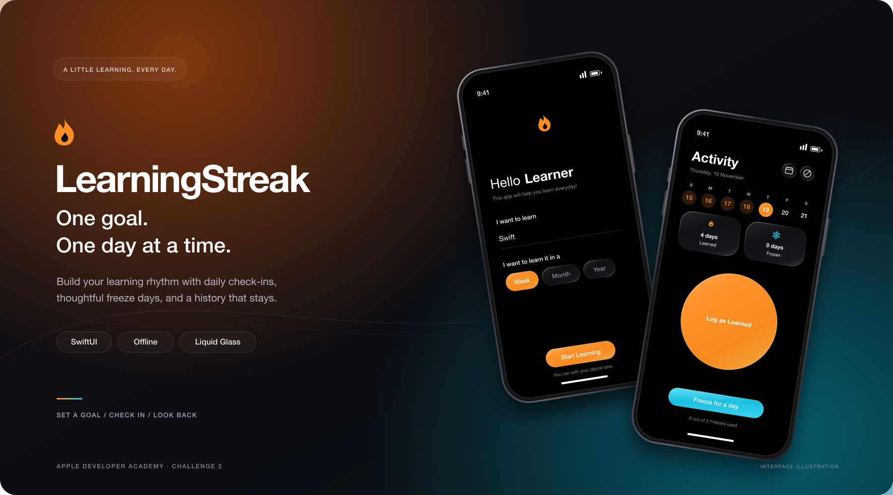
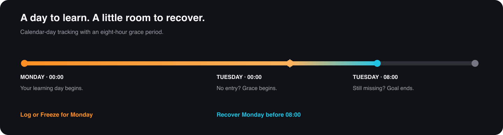
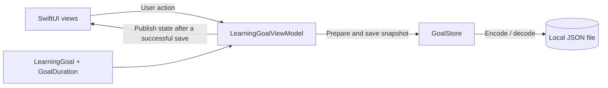

<p align="center">
  
</p>

<h1 align="center">LearningStreak</h1>
<p align="center"><strong>One goal. One day at a time.</strong></p>
<p align="center">An offline iOS app for turning a learning intention into a daily check-in.</p>
<p align="center"><strong>SwiftUI</strong> &nbsp;·&nbsp; <strong>MVVM</strong> &nbsp;·&nbsp; <strong>Liquid Glass</strong> &nbsp;·&nbsp; <strong>Local persistence</strong></p>
<p align="center">
  <a href="#the-idea">Overview</a> ·
  <a href="#what-you-can-do">Features</a> ·
  <a href="#how-it-works">App flow</a> ·
  <a href="#the-rules-in-plain-english">Goal rules</a> ·
  <a href="#run-it-locally">Get started</a> ·
  <a href="#under-the-hood">Architecture</a> ·
  <a href="#testing">Testing</a>
</p>

<sub>The cover contains stylized interface illustrations based on the app’s screens; it is not a device screenshot.</sub>

---

## The idea

**LearningStreak helps you commit to one learning goal, record each day as Learned or Frozen, and follow your progress through an activity calendar.** Set a time frame, check in daily, and start a fresh goal when your current one ends.

The app is built around a small interaction: **“Did I learn today, or do I need a freeze?”** It tracks your commitment; the learning itself happens wherever you choose—while studying Swift, practising a language, reading, or developing another skill.

Developed for **Apple Developer Academy — Challenge 2**, this project brings together SwiftUI interface design, state management, date-based business rules, local persistence, and iterative testing.

## What you can do

| Feature | What it means in the current build |
|---|---|
| **Set a learning goal** | Enter what you want to learn and choose Week, Month, or Year. One goal is active at a time. |
| **Log a learned day** | Record learning for the displayed day with the main circular button. |
| **Use a freeze** | Cover a day without adding to the Learned count, within the goal’s freeze allowance. |
| **Change your mind** | Tap the selected action again to undo it, or switch between Learned and Frozen. A day never holds both states in the same goal. |
| **Recover a missed day** | If yesterday has no entry, record it during the eight-hour grace period shown in the app. |
| **See your activity** | Review the current week and a scrolling monthly calendar. Earlier recorded activity remains visible after starting a new goal. |
| **Start again deliberately** | Confirm a goal update before starting a new cycle with fresh counters. |
| **Keep progress between launches** | The app saves the goal and activity locally, then restores them when reopened. |

**No sign-in, backend, or internet connection is required for these features.**

## How it works

### 1. Choose a direction

On the onboarding screen, enter your learning goal and select a duration. The Start Learning button becomes available when the name contains more than whitespace.

Starting the goal creates a unique ID, records its start date, and saves it before opening Activity.

### 2. Check in for the day

Activity brings together:

- **A weekly strip** with the current day and recorded activity.
- **Learned and Frozen cards** showing counts for the current goal.
- **Log as Learned**, the main circular action.
- **Freeze for a day**, plus the number of freezes already used.
- **Calendar and goal controls** for reviewing history or changing the goal.

The buttons are reversible while the displayed day remains editable:

| Current state | Tap Log | Tap Freeze |
|---|---|---|
| No entry | Record Learned | Record Frozen if a freeze is available |
| Learned | Remove the learned entry | Replace it with Frozen if a freeze is available |
| Frozen | Replace it with Learned and return the freeze | Remove the frozen entry and return the freeze |

A grey selected action can still be tapped to undo it. If the freeze allowance is exhausted, attempting to freeze another day does not remove an existing learned entry.

### 3. Look back

The Activities calendar opens at the **current month**, with the next two months below it and previous months above it when history exists. The range grows as time moves forward; choosing Year does not immediately display a full future year.

Orange indicates learned activity, cyan indicates frozen activity, and the current day has its own highlight. The calendar is **read-only**: tapping a past date does not edit its record.

### 4. Finish—or make a fresh start

At the end of the selected period, the app shows a success state if every goal day is covered by Learned or Frozen activity. If a missing day reaches its grace deadline, the goal fails and its logging controls close.

**Set a goal** opens a blank goal name and the default Week duration. Reusing the same name and duration still creates a new goal ID, start date, and set of counters. It does not resume a failed goal.

Updating an active goal also starts a new cycle, so the app asks for confirmation first. Returning from the edit page or dismissing the confirmation leaves the current goal unchanged. The activity calendar keeps the earlier recorded days.

## The rules, in plain English

### A week really is seven days

| Selected duration | How the end date is calculated | Freeze allowance for that goal |
|---|---|---:|
| **Week** | Seven consecutive calendar days from the start date | 2 |
| **Month** | One calendar month from the start date | 8 |
| **Year** | One calendar year from the start date | 96 |

There are **no automatic weekend exemptions**. Saturday, Sunday, and every other day follow the same rules. A month is not hard-coded as 30 days, and a year is not hard-coded as 365 days.

The start day is included and the end date is excluded. For example, a weekly goal starting on Monday covers **Monday through Sunday** and reaches its normal end at the start of the next Monday.

Freeze allowances belong to the entire goal; they do not refill every week or month. Frozen days preserve continuity but do not increase the Learned count. Therefore, **5 Learned + 2 Frozen can complete a seven-day goal, but five elapsed days cannot**.

### The daily deadline: a day plus eight hours



A day normally runs from midnight to midnight. If it has no Learned or Frozen entry when it ends, the app gives that day until **8:00 AM the following morning**.

For a missing Monday:

1. **Monday:** log learning or use a freeze during the day.
2. **Tuesday, 00:00–07:59:59:** the grace notice appears, and the action buttons recover **Monday**, not Tuesday.
3. **After recovery:** switch or undo that entry while its grace period is still open, or choose **Continue to Today** to check in for Tuesday.
4. **Tuesday, 08:00:** if Monday still has no entry, the goal fails.

The last day of a goal receives the same grace period if needed. A fully covered period can succeed at its normal end; an uncovered last day remains recoverable until its deadline.

The app rechecks these rules when it opens, returns to the foreground, or performs an activity action. While open, it also refreshes at midnight and at 8 AM. It does not need to stay open for a missing day to expire. The grace notice is **inside the app**; the current build does not send local or push notifications.

<details>
<summary><strong>A note about time and time zones</strong></summary>

The deadline follows calendar days rather than a rolling timer from the last button press. The first day is the calendar date on which the goal is created, so starting late in the evening does not create a new 24-hour day from that moment.

The app retains a time-zone identifier with the stored activity, keeping day boundaries consistent when the device’s time zone changes. In Riyadh, a full calendar day plus the grace period is 32 elapsed hours. In a daylight-saving time zone, the rule still ends at 8 AM local time even when the elapsed hour count differs.

Once a failure has been saved, setting the device clock backwards does not reopen that goal. A new goal starts a separate cycle.

</details>

## Design and implementation

The visual language combines a black canvas, **orange for learning**, **cyan for freezes**, capsule controls, a prominent circular check-in action, and rounded activity cards.

Liquid Glass is applied through a shared `streakGlass` helper. Controls retain their individual shapes and colours, while the counter cards use a noninteractive treatment. A subtle gradient rim helps define surfaces against the dark background. The confirmation window uses matching button dimensions, white labels, and an orange Update action.

The app icon is supplied through the included **Icon Composer** file, `LJ_Icon.icon`.

### Technologies

| Technology | Role |
|---|---|
| **Swift + SwiftUI** | App structure, screens, layout, and interactions |
| **Observation** | `@Observable` model updates and `@Bindable` input bindings |
| **Foundation Calendar** | Goal durations, day boundaries, month grids, and grace deadlines |
| **Codable + JSON** | Encoding and decoding local app state |
| **FileManager** | Reading and atomically writing the saved snapshot |
| **UIKit notifications** | Responding to significant system time changes |
| **SF Symbols + Icon Composer** | Interface symbols and the application icon |

No third-party runtime packages are required by the app.

## Run it locally

### Requirements

| Requirement | Current project configuration |
|---|---|
| Development environment | A Mac with Xcode supporting the iOS 27.2 SDK; Xcode 27.2 is the straightforward choice |
| iPhone / Simulator | iOS 27.2 or later |
| Xcode target | `Learning` |
| Displayed app name in this README | LearningStreak |
| External services | None |

These requirements reflect the checked-in project settings. Availability checks in a view helper do not, by themselves, lower the app’s deployment target.

### Setup

```bash
git clone https://github.com/ShahadW95/LearningStreak.git
cd LearningStreak
open Learning.xcodeproj
```

1. Open the project in Xcode and choose the **Learning** scheme/target.
2. Select a compatible iPhone simulator, or connect your iPhone.
3. For a physical device, select your development team under **Signing & Capabilities** and use an appropriate unique bundle identifier.
4. Build and run with **⌘R**.
5. Create a goal, log a day, and open the calendar to explore the main flow.

The icon is already referenced by the project as `LJ_Icon`. There are no API keys, account credentials, or package-installation steps to configure.

## Under the hood

The app uses a small **MVVM-style structure** with a separate persistence component:



### Responsibilities

| Component | Responsibility |
|---|---|
| **LearningGoal** | A goal’s ID, title, duration, and start date |
| **GoalDuration** | Available durations, calendar arithmetic, and freeze limits |
| **LearningGoalViewModel** | Activity transitions, validation, grace recovery, failure, completion, calendar data, and goal changes |
| **GoalStore** | Loading and saving one consistent snapshot |
| **MyApp / RootView** | Owning one shared view model, selecting the root screen, and refreshing date-sensitive state |
| **Views** | Presenting state and sending actions to the view model |

The view model receives a `now` closure, allowing tests to control time without changing the device clock. `GoalStore` also accepts a custom file URL, so tests can use disposable storage.

### Project map

```text
LearningStreak/
├── Learning.xcodeproj/
├── LJ_Icon.icon/
├── LearningStreak/
│   ├── MyApp.swift
│   ├── Models/
│   │   └── LearningGoal.swift
│   ├── ViewModels/
│   │   └── LearningGoalViewModel.swift
│   ├── Services/
│   │   └── GoalStore.swift
│   ├── Views/
│   │   ├── OnboardingView.swift
│   │   ├── ActivityView.swift
│   │   ├── HistoryView.swift
│   │   └── EditGoal/
│   │       └── EditGoalView.swift
│   └── Assets.xcassets/
├── Tests/
│   └── WeekDurationChecks.swift
├── docs/assets/
└── README.md
```

The source folder also contains a template `ContentView.swift`; the running app’s entry point is **MyApp**, which routes through **RootView**.

## Storage and privacy

Progress is stored in an app-local JSON snapshot at:

```text
Application Support/LearningStreak/goal-v1.json
```

The snapshot includes the current goal, learned and frozen dates, archived activity dates, an optional failed-day marker, and the time-zone identifier.

- **Save first, then display success.** Failed writes leave the previous activity state visible and show an error.
- **Protect unreadable data.** If loading or validation fails, the app does not silently replace the saved file with an empty goal.
- **Keep earlier days.** Starting a new goal archives the recorded dates; it does not erase the calendar history.
- **Keep the scope local.** There is no account system, app backend, cloud-sync implementation, or analytics SDK in the current source.

The archive stores recorded dates, not a separate browsable profile for every previous goal. If different goals record the same date as Learned and Frozen, the combined calendar gives Learned precedence.

## Testing

### Included automated checks

[`Tests/WeekDurationChecks.swift`](Tests/WeekDurationChecks.swift) contains **17 standalone regression checks** against the actual model, store, and view model. They cover:

- Seven-day weekly duration and the correct end date.
- No premature success after five or six learned days.
- Saturday and Sunday as ordinary goal days.
- Completion only after the selected period ends.
- Five Learned plus two explicitly Frozen days across a full week.
- Failure when a weekend day is left uncovered past its deadline.
- Recovery and expiry of the final day’s grace period.

Run them from the repository root on a Mac with the Xcode command-line tools selected:

```bash
xcrun swiftc -parse-as-library \
  LearningStreak/Models/LearningGoal.swift \
  LearningStreak/Services/GoalStore.swift \
  LearningStreak/ViewModels/LearningGoalViewModel.swift \
  Tests/WeekDurationChecks.swift \
  -o /tmp/learningstreak-week-checks && /tmp/learningstreak-week-checks
```

Expected result:

```text
Passed 17 weekly duration checks.
```

This is a standalone test runner with its own `@main`; it should **not** be added to the application target.

### Suggested on-device checks

| Flow | What to verify |
|---|---|
| Onboarding | A blank name cannot start a goal; a valid name opens Activity. |
| Toggle and replace | Log → undo, Freeze → undo, and switching between them keep counts consistent. |
| Freeze allowance | Replacing a freeze with learning returns it; an exhausted allowance does not erase a learned entry. |
| Edit cancellation | Back and Dismiss leave the saved goal unchanged. |
| Confirmed update | A new ID and counters are created, while old activity stays in the calendar. |
| Relaunch | The saved goal and activity are restored. |
| Grace period | Yesterday’s entry is recoverable before 8 AM; it cannot be recovered after its deadline. |
| End states | Success and failure show the appropriate message and allow a fresh goal. |
| Presentation | Check small screens, keyboard behaviour, larger text, and VoiceOver. |

The included regression checks are not a claim of complete UI or accessibility test coverage. The app’s time-sensitive screens should also be exercised on a simulator or device.

## Current scope

LearningStreak intentionally focuses on one goal and one daily check-in. The current build does not include learning content, multiple simultaneous goals, scheduled reminders, social features, cloud sync, or free editing of past activity.

There is no hidden testing panel in the application. Time-based regression checks use the injected clock in the standalone runner.

## Maintainer and feedback

Maintained by **[ShahadW95](https://github.com/ShahadW95)** as an Apple Developer Academy learning project.

For a reproducible problem, include the selected duration, device/iOS version, relevant dates and time zone, the actions taken, and the expected versus actual result. Feedback can be shared through this repository’s [Issues](https://github.com/ShahadW95/LearningStreak/issues).

## Documentation references

The README’s organization draws on [GitHub’s README guidance](https://docs.github.com/en/repositories/managing-your-repositorys-settings-and-features/customizing-your-repository/about-readmes), the visual-first presentation of [Ice Cubes](https://github.com/Dimillian/IceCubesApp), and the section structure of [Best-README-Template](https://github.com/othneildrew/Best-README-Template).

For the platform APIs, see Apple’s [SwiftUI documentation](https://developer.apple.com/documentation/swiftui), [Liquid Glass](https://developer.apple.com/documentation/swiftui/glass), and [Icon Composer](https://developer.apple.com/icon-composer/).

---

<p align="center"><strong>Small steps. Visible progress. A fresh start when you need one.</strong></p>
